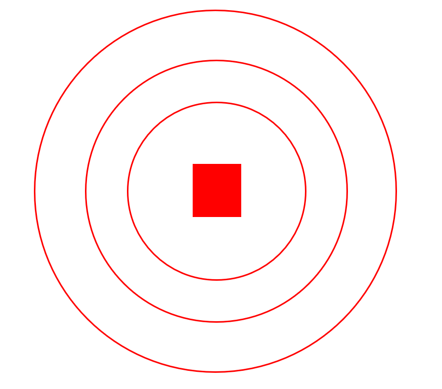
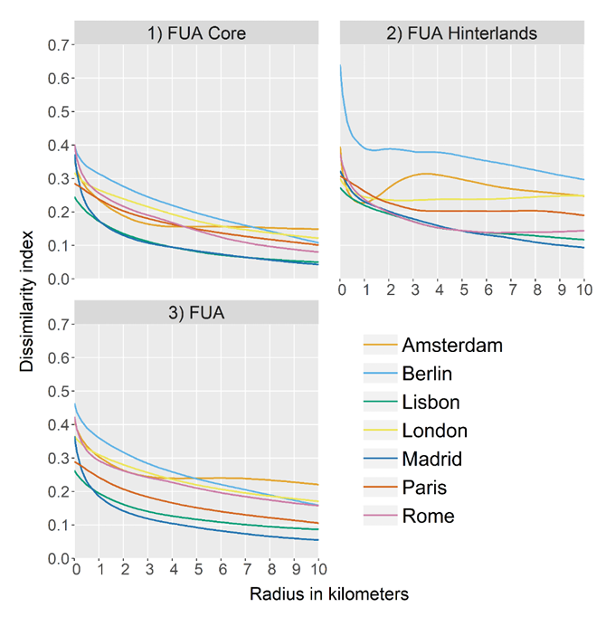
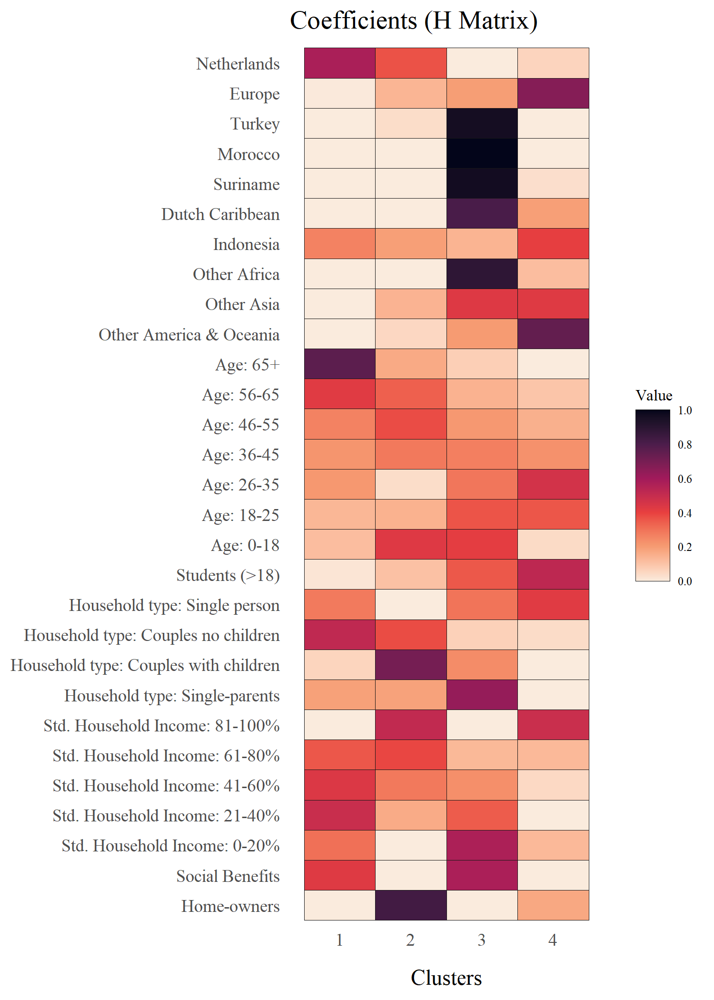
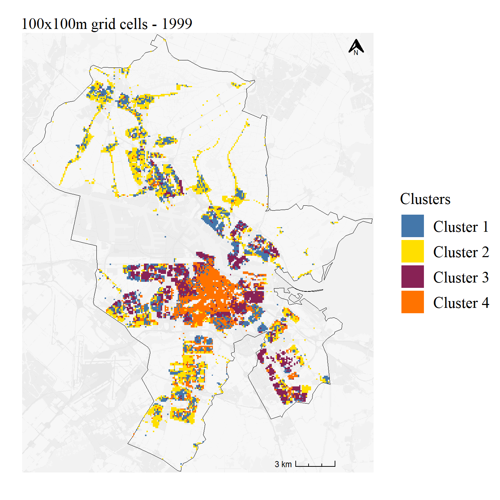
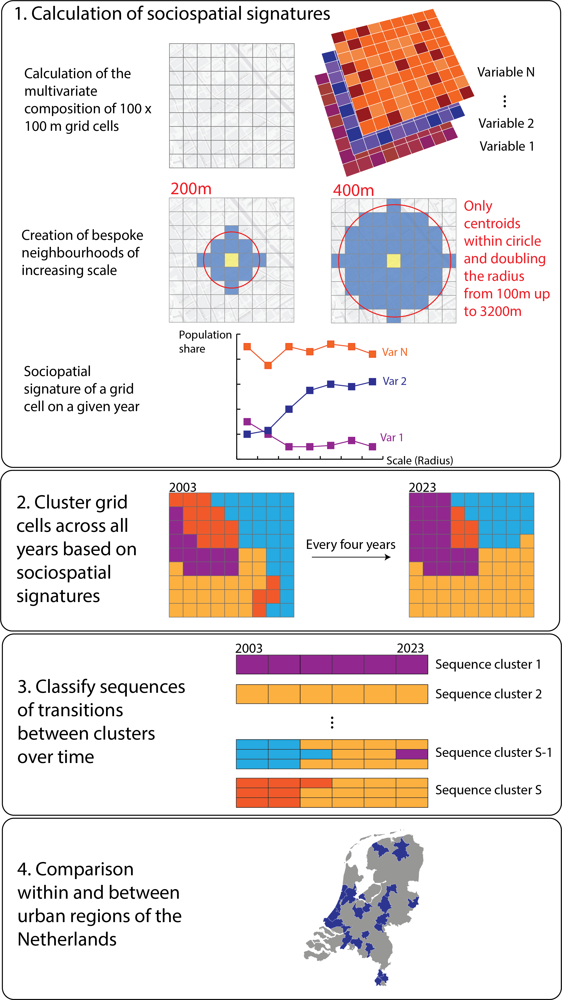
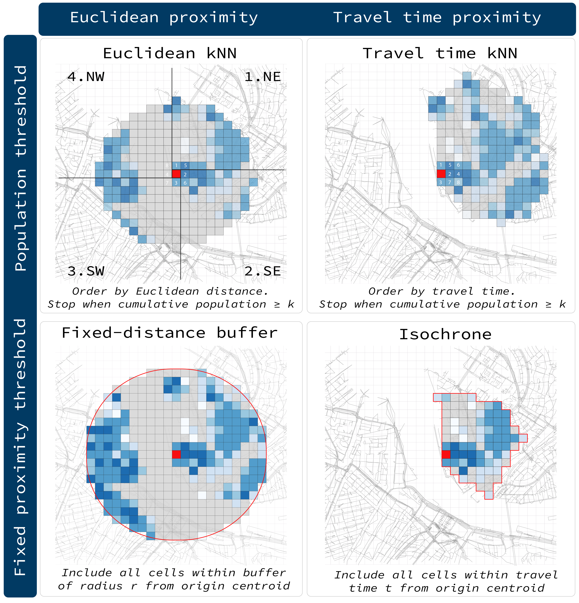

## Bespoke neighbourhoods

::::: columns
::: {.column .fragment width="50%"}
{height="600px"}
:::

::: {.column .fragment width="50%"}
{height="600px"}

<p class="figure-source">

Source: @petrovic2026

</p>
:::
:::::

## Bespoke neighbourhoods in practice: clustering of buffers

```{=html}
<div style="display: flex; gap: 10px; align-items: flex-start;">

  <div style="width: 30%; font-size: 20px;">

    <label>Year: <span id="year-label">1999</span></label>
    <input type="range" id="year" min="0" max="6" value="0"
           style="width: 100%;">

    <label>Scale: <span id="scale-label">Grid</span></label>
    <input type="range" id="scale" min="0" max="6" value="0"
           style="width: 100%;">

    

  </div>

  <div style="width: 70%;">
    
  </div>

</div>

<script>
  const years = [1999, 2003, 2007, 2011, 2015, 2019, 2022];
  const scales = ["Grid", "100m", "200m", "400m", "800m", "1600m", "3200m"];

  function updateMap() {
    const year = years[document.getElementById("year").value];
    const scale = scales[document.getElementById("scale").value];

    document.getElementById("year-label").textContent = year;
    document.getElementById("scale-label").textContent = scale;

    document.getElementById("amsterdam-map").src =
      `images/clusters_NMF_k4_scale${scale}_${year}_metaggl_10.bmp`;
  }

  document.getElementById("year").addEventListener("input", updateMap);
  document.getElementById("scale").addEventListener("input", updateMap);
</script>
```

<small>Source: @urria2025</small>

## Bespoke neighbourhoods in practice: clustering of multiscale profiles {.scrollable}

::: {style="display: flex; justify-content: center; align-items: center; height: 950px;"}
{height="900px"}
:::

<small>Source: @urria2026</small>

## Different ways of creating bespoke neighbourhoods

::: {style="display: flex; justify-content: center; align-items: center; height: 750px;"}
{height="700px"}
:::

## What does this imply for the computation of urban segregation in R?

1.  **Bespoke neighbourhood construction:** provide multiple operationalisations based on population, distance and travel time
2.  **Multiscale segregation measures:** calculate segregation indices and distance profiles to integrate with classification methodologies
3.  **Sensitivity and comparison:** Common output structure across operationalisations for comparison across scales, places and operationalisations

## Thank you {.scrollable .smaller}

::: {#refs}
:::